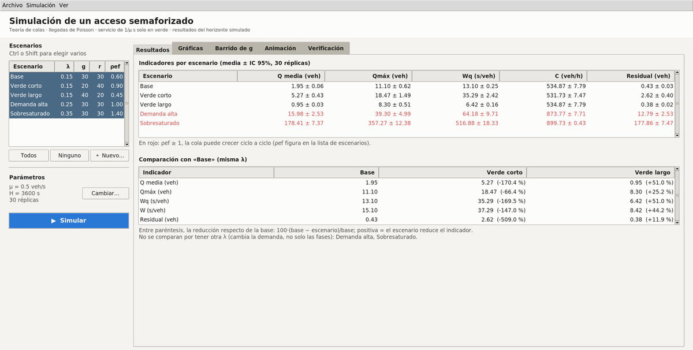
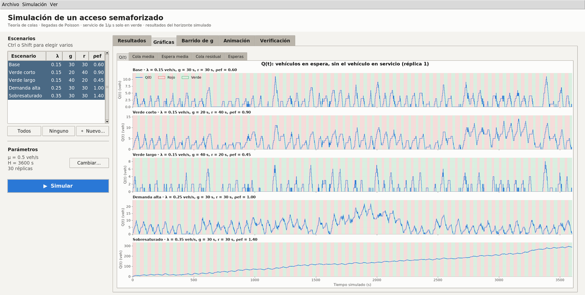
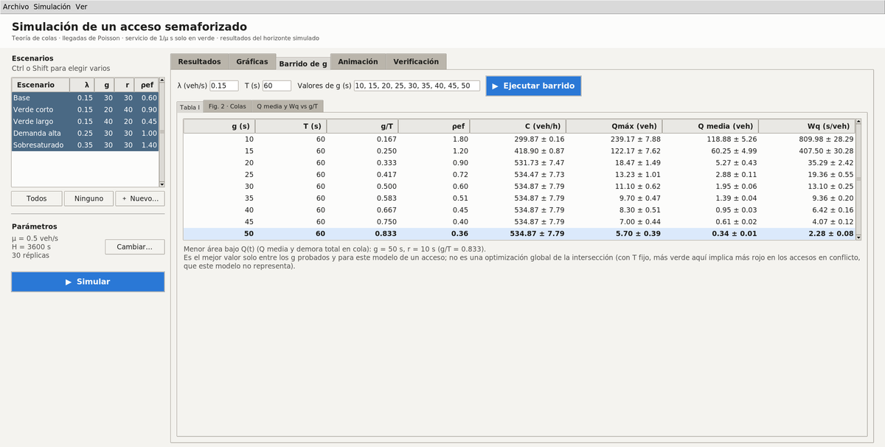
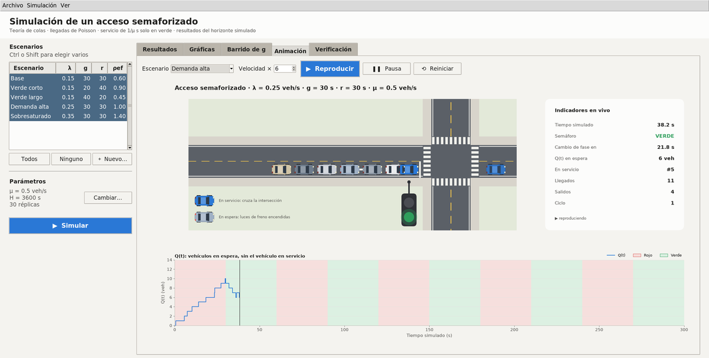

# Simulación de un acceso semaforizado con teoría de colas

## Descripción

Simulador de eventos discretos de un acceso semaforizado. Los vehículos llegan
según un proceso de Poisson, esperan en una cola FIFO y se atienden de uno en
uno en 1/μ s, solo durante el verde. Con réplicas independientes e intervalos
de confianza compara configuraciones del semáforo y muestra cómo cambian la
cola y la espera según el tiempo de verde.

Es la parte computacional del proyecto *Modelado y análisis del flujo
vehicular mediante teoría de colas para la optimización de tiempos de semáforo
en intersecciones viales*.

## Tecnologías

| Tecnología | Uso |
|---|---|
| Python 3.10+ | Lenguaje |
| NumPy | Llegadas aleatorias y métricas |
| SciPy | Intervalos de confianza (t de Student) |
| Matplotlib | Gráficas y animación |
| Tkinter | Interfaz gráfica |
| Pillow | Exportación de la animación a GIF |
| pytest | Pruebas automáticas |

## Instalación

Requisito: Python 3.10 o superior con Tkinter.

**Opción 1: entorno virtual (recomendada).** En Debian/Ubuntu, primero
`sudo apt install python3-venv python3-tk`.

```bash
cd simulacion_semaforo
python3 -m venv .venv
source .venv/bin/activate        # Windows: .venv\Scripts\activate
pip install -r requirements.txt
```

**Opción 2: paquetes del sistema (Debian/Ubuntu, sin pip).** En este caso, los
comandos se ejecutan con `python3` en lugar de `python`.

```bash
sudo apt install python3-numpy python3-scipy python3-matplotlib python3-pil python3-pytest python3-tk
```

**VS Code instalado como Flatpak.** Su terminal integrada no tiene estas
bibliotecas. `main.py` lo detecta y se vuelve a ejecutar en el sistema, así que
no hace falta configurar nada.

## Ejecución

Desde `simulacion_semaforo/`, con el entorno virtual activado:

| Comando | Acción |
|---|---|
| `python main.py --gui` | Interfaz gráfica |
| `python main.py` | Menú de consola |
| `python main.py --pruebas --no-menu` | Pruebas de verificación |
| `python main.py --all --no-menu` | Los 5 escenarios, comparados con la base |
| `python main.py --escenario "Verde largo" --no-menu` | Un escenario |
| `python main.py --barrido --no-menu` | Barrido de g (Tabla I y Fig. 2) |
| `python main.py --traza Base --no-menu` | Traza de eventos de una réplica |
| `python main.py --animate Base --gif --no-menu` | Animación; también la guarda como GIF |
| `python -m pytest -v` | Pruebas con pytest |
| `python main.py --help` | Todas las opciones |

Sin `--no-menu`, al terminar las acciones se abre el menú. Atajos de la
interfaz:

* F5: simular.
* F11: pantalla completa.
* Ctrl+S: guardar los resultados.

Las pestañas Ciclos y Traza se muestran desde *Ver → Pestañas técnicas*.

### Configuración

Los parámetros están en `config/config.json`. También se pueden cambiar al
ejecutar, sin editar el archivo:

```bash
python main.py --all -n 50 --H 7200 --no-menu                          # 50 réplicas de 2 h
python main.py --escenario Prueba --lam 0.2 --g 25 --r 35 --no-menu    # escenario nuevo
```

Valores por defecto:

* μ = 0.5 veh/s, H = 3600 s y n = 30 réplicas.
* Confianza del 95 %.
* Semilla base 2025: la réplica i usa la semilla 2025 + i.

| Escenario | λ (veh/s) | g (s) | r (s) |
|---|---|---|---|
| Base | 0.15 | 30 | 30 |
| Verde corto | 0.15 | 20 | 40 |
| Verde largo | 0.15 | 40 | 20 |
| Demanda alta | 0.25 | 30 | 30 |
| Sobresaturado | 0.35 | 30 | 30 |

## Estructura del proyecto

```
simulacion_semaforo/
├── main.py                    # Punto de entrada: menú, línea de comandos e interfaz
├── config/
│   ├── config.json            # Parámetros y escenarios
│   ├── settings.py            # Carga y validación de la configuración
│   └── entorno.py             # Detección del sandbox Flatpak y de dependencias faltantes
├── model/                     # Simulación de eventos discretos
│   ├── events.py              # Tipos de evento, prioridades y agenda
│   ├── traffic_light.py       # Fases del semáforo
│   ├── arrivals.py            # Proceso de llegadas (Poisson)
│   ├── vehicle.py             # Vehículo
│   ├── simulator.py           # Motor de la simulación
│   └── statistics.py          # Métricas de una réplica
├── controller/
│   ├── experiment_service.py  # Réplicas, escenarios, comparación, barrido y pruebas
│   ├── analysis.py            # Media, desviación estándar e intervalos de confianza
│   ├── console_controller.py  # Menú de consola
│   ├── cli.py                 # Argumentos de línea de comandos
│   └── aplicacion.py          # Crea y conecta los componentes
├── view/
│   ├── console_view.py        # Tablas y mensajes de consola
│   ├── plots.py               # Gráficas
│   ├── csv_export.py          # Escritura de CSV
│   ├── exportacion.py         # Archivos que produce cada experimento
│   ├── formato.py             # Textos comunes a consola e interfaz
│   ├── style.py               # Paleta de colores
│   ├── entorno_grafico.py     # Diagnóstico del entorno gráfico de matplotlib
│   ├── animacion/             # Animación de la intersección (ventana, interfaz y GIF)
│   └── gui/                   # Interfaz gráfica: ventana, panel de escenarios y pestañas
├── tests/
│   └── test_verification.py   # Pruebas de verificación
├── docs/capturas/             # Imágenes de este README
├── output/                    # Resultados generados
├── pytest.ini
└── requirements.txt
```

**Arquitectura (MVC y SOLID).**

* El modelo no depende de las demás capas. El controlador ejecuta el modelo y
  las vistas (consola, interfaz, gráficas, CSV y animación) solo muestran los
  resultados.
* Cada clase tiene una sola responsabilidad y recibe sus dependencias en el
  constructor. `controller/aplicacion.py` es el único lugar que crea y conecta
  las piezas.
* Se puede ampliar sin modificar lo existente:
  * un proceso de llegadas nuevo implementa `ProcesoLlegadas`;
  * una gráfica nueva es una fila más en `FIGURAS`;
  * una pestaña nueva se registra como receptora en la ventana.

## Información adicional

### Funcionalidades

* Simulación de escenarios con n réplicas, semillas registradas y números
  aleatorios comunes: todas las configuraciones reciben las mismas llegadas.
* Indicadores con media ± intervalo de confianza:
  * cola media Q̄ y cola máxima;
  * espera en cola Wq y tiempo en el sistema W;
  * capacidad efectiva C;
  * cola residual al final de cada verde.
* Comparación porcentual de cada escenario con la base (misma λ).
* Barrido del tiempo de verde g con ciclo fijo (Tabla I y Fig. 2 del informe).
* Traza de eventos y vehículos atendidos por ciclo.
* Animación de la intersección con pausa y reinicio, exportable a GIF.
* 9 pruebas de verificación: balance de vehículos, ninguna salida en rojo,
  reproducibilidad, capacidad por verde, orden de eventos, sobresaturación y
  validación de entradas.
* Resultados en `output/`:
  * CSV de resumen, réplicas, ciclos, traza, comparación y barrido;
  * 7 gráficas PNG.

### Modelo

* Un acceso, con una cola FIFO sin límite de capacidad y un servidor.
* Semáforo de tiempo fijo: verde g, rojo r y ciclo T = g + r. La simulación
  empieza en rojo.
* Servicio determinista de 1/μ s, solo en verde y solo si termina antes de
  que acabe el verde.
* Q(t) cuenta los vehículos en espera, sin el que está en servicio.
* Orden de los eventos simultáneos: salida → cambio de fase → llegada.
* ρef = λT/(μg) compara la demanda por ciclo con la capacidad del verde. Con
  ρef ≥ 1 la cola puede crecer ciclo a ciclo.

### Limitaciones

* No se ha validado con datos de campo, y μ = 0.5 veh/s es un valor provisional.
* Se modela un solo acceso. Con T fijo, más verde siempre reduce su cola, por
  eso el mejor g del barrido es siempre el mayor probado. No es una
  optimización de toda la intersección.
* No hay fase amarilla, tiempo perdido al arrancar ni llegadas en pelotón.
* La simulación empieza vacía y sin calentamiento, así que los resultados
  describen el horizonte simulado y no un régimen estacionario.

### Capturas

| Resultados | Gráficas |
|---|---|
|  |  |
| **Barrido de g** | **Animación** |
|  |  |

### Autores

Juan Calopino, Daniel Saavedra, Anthony Yaguana y Odalis Rosillo.
Computación, Universidad Nacional de Loja (Ecuador).
